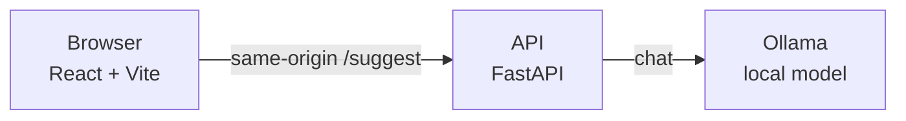

# 2048 with AI suggestions

Single-player 2048 in the browser with an AI coach: ask a local **LLM** (Ollama) or an **Expectimax** search for the next move, confirm it with **Play**, or let **Auto Play** apply suggestions in a loop.



The game rules run in the browser. The server has one job: given a board and a mode, return a legal move and a short reason.

## Quick start

Prerequisites: Node.js + npm, Python ≥ 3.11 with [uv](https://github.com/astral-sh/uv), and [Ollama](https://ollama.com).

```bash
# Terminal 1 — local model for LLM mode (default OLLAMA_MODEL=gemma4:latest)
ollama pull gemma4:latest && ollama serve        # skip `serve` if the Ollama app is already running
# Terminal 2 — API on :8000
cd server && uv sync --extra dev && uv run uvicorn app.main:app --reload --host 127.0.0.1 --port 8000
# Terminal 3 — client on :5173 (proxies /suggest to the API)
cd client && npm install && npm run dev
```

Open `http://localhost:5173`, press **AI** for a suggestion, then **Play** to apply it. The first LLM suggestion can take 10–20s while the model loads and thinks; later ones are faster. Expectimax mode needs no model. Without Ollama, LLM mode says the AI could not suggest a move, and the game itself is unaffected. Docker Compose, other ports, and the optional ops stack: [getting started](docs/getting-started.md).

Tests and lint:

```bash
cd server && uv run pytest && uv run ruff check . && uv run ruff format --check .
cd client && npm test && npm run lint && npm run build
```

## Docs

| Audience | Start here |
|---|---|
| **Humans:** what this is and how it's built | [docs/](docs/README.md) |
| **Pitch page:** diagram-heavy walkthrough | [Live site](https://christycty.github.io/game-2048/) · [source](site/index.html) |
| **Agents:** rules, invariants, implementation detail | [AGENTS.md](AGENTS.md) → [docs/agents/](docs/agents/README.md) |


## Feature map

| # | Feature | Code | Tests |
|---|---|---|---|
| 1 | Initial board with a random number of `2`s | [`createInitialTiles`](client/src/game/game.js) | [`game.test.js`](client/src/game/game.test.js) |
| 2–4 | Move left / right / up / down | [`applyMove`](client/src/game/game.js) (client), [`moves.py`](server/app/moves.py) (server legality) | [`game.test.js`](client/src/game/game.test.js), [`test_moves.py`](server/tests/test_moves.py), including the documented example boards |
| 5 | Spawn a `2` or `4` after each board-changing move | [`applyMove`](client/src/game/game.js) | [`game.test.js`](client/src/game/game.test.js) |
| 5 | Endgame: lose when no moves, win at 2048 | [`hasMoves` / `hasWon`](client/src/game/game.js), overlay in [`Board.jsx`](client/src/components/Board.jsx) | [`game.test.js`](client/src/game/game.test.js), [`Board.test.jsx`](client/src/components/Board.test.jsx) |
| 6 | AI suggestion (offline model, no credentials) | [`suggester.py`](server/app/suggester.py), [`llm.py`](server/app/llm.py), [`expectimax.py`](server/app/expectimax.py) | [`test_suggest.py`](server/tests/test_suggest.py), [`test_expectimax.py`](server/tests/test_expectimax.py), [`App.test.jsx`](client/src/App.test.jsx) |

Suggested reading order: `client/src/game/game.js` → `server/app/moves.py` → `server/app/suggester.py` → `server/app/llm.py` / `expectimax.py` → `server/app/main.py`.

## Assumptions

Where product rules are silent, classic 2048 decides. Where they conflict, the product rules win.

- **Opening deal:** a uniform random count from 1 to 16 of `2`s on distinct random cells. The product asks for a random number; classic 2048 deals two tiles.
- **Spawn:** one tile on a uniformly random empty cell, a `2` 90% of the time and a `4` 10% of the time. A move that changes nothing spawns nothing and scores nothing.
- **Merging:** each tile merges at most once per move, and pairs nearest the move direction merge first (`[2,2,2,2]` left → `[4,4,_,_]`).
- **Win is a hard stop:** the game ends on the move that makes a 2048 tile. There is no "keep playing". If that move also fills the board, the win still counts.
- **Score:** the sum of merged values (as in classic 2048). Best score lasts for the page session only.
- **API board format:** `0` stands for an empty cell (some write-ups use `null`). The server accepts only 4×4 boards whose tiles are `0` or powers of two.
- **AI suggestions are advisory.** The player confirms with **Play** or ignores the hint. The server checks every move for legality before returning it. When the LLM fails after retries, the server returns a deterministic legal move marked `source: "fallback"`, and the UI says the AI could not suggest rather than presenting it as advice.
- **Two AI modes.** The LLM is the primary mode because the coach is framed as an AI model. Expectimax is a depth-limited search that plays noticeably better than a small local model, so it is offered alongside.
- **Local model only:** Ollama on the host, with no API keys anywhere. A remote provider would be another `LlmClient` implementation.
- **No accounts or persistence:** games are not saved, and there is no auth. Multiple browser sessions can share one API (spend and capacity caps are process-wide, not per player). Undo and leaderboards are out of scope.

## Production readiness

`/suggest` can be slow, concurrent, and cancelled mid-flight. These controls keep that path reliable, bounded, and observable:

- **Reliability:** each LLM call has a timeout, retries happen within an overall time budget, and the retry prompt explains what was wrong with the last reply. The reply is validated and its reason length capped, and a legal fallback move is always available. When the browser disconnects (Stop, New Game, a manual move), the server cancels the in-flight model call or search.
- **Abuse and cost limits:** for each mode, a sliding-window ceiling on requests caps total spend, and a cap on concurrent calls stops the model being overloaded. The two return distinct `429` responses, so Auto Play can retry when the model is busy but stops when the spend limit is hit.
- **Observability:** OpenTelemetry traces of each suggestion from the API to the model call, tied to the browser request by a W3C `traceparent` header (Phoenix, opt in with `EXPORT_TRACES=true`), and Prometheus metrics with a Grafana dashboard (`--profile metrics`). Both are optional, and the app runs the same without them.
- **Delivery:** Pydantic validation, dev/prod Docker Compose profiles (prod serves the client through nginx and keeps the API unpublished), a locked `uv` build, pre-commit hooks, and CI for lint, tests, Docker build and doc links.

Detail: [architecture](docs/architecture.md), [runtime and limits](docs/agents/runtime.md), [telemetry](docs/agents/telemetry.md).
