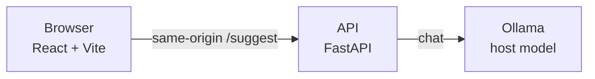

# 2048 with AI suggestions

A single-player 2048 game in the browser, with an optional AI coach that suggests the next move. Confirm each suggestion with **Play**, or turn on **Auto Play** to apply them in a loop.



- Play classic 2048 (keys or swipe); track score and session best.
- Ask for a suggestion (LLM by default, or Expectimax search with per-direction scores).
- Confirm with **Play**, ignore it and move yourself, or start **Auto Play** to keep applying suggestions until you stop.

## Quick start

```bash
# Terminal 1 — Ollama on the host (model from OLLAMA_MODEL, default gemma4:latest)
# Terminal 2
cd server && uv sync --extra dev && uvicorn app.main:app --reload --host 127.0.0.1 --port "${API_HOST_PORT:-8000}"
# Terminal 3
cd client && npm install && npm run dev
```

Open `http://127.0.0.1:${CLIENT_HOST_PORT:-5173}`. Or use Compose: `cp .env.example .env` then `docker compose --profile dev up` (see [getting started](docs/getting-started.md)). Per-worktree ports: `API_HOST_PORT`, `CLIENT_HOST_PORT`, `COMPOSE_PROJECT_NAME`.

## Docs

| Audience | Start here |
|---|---|
| **Humans** — what this is and how it’s built | [docs/](docs/README.md) |
| **Pitch page** — diagram-heavy presentation (GitHub Pages) | [site/](site/index.html) |
| **Agents** — rules, invariants, implementation detail | [AGENTS.md](AGENTS.md) → [docs/agents/](docs/agents/README.md) |
