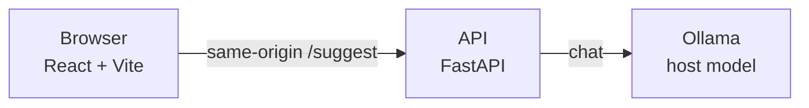

# 2048 with AI suggestions

Single-player 2048 with an optional AI coach (**LLM** via Ollama or **Expectimax**), **Auto Play**, and local ops (Phoenix traces + Prometheus / Grafana).



- Play classic 2048 (keys or swipe): random opening **2**s (1–16), hard win at **2048**, score + session best.
- Ask for a suggestion (LLM or Expectimax with per-direction scores), confirm with **Play**, or ignore and move yourself.
- **Auto Play** applies suggestions in a loop until you **Stop** (retries when the model is busy; stops on spend-cap 429).
- Optional ops: host Phoenix for per-request traces; Compose `--profile metrics` for Prometheus / Grafana.

## Quick start

```bash
# Terminal 1 — API
cd server && uv sync --extra dev && uv run uvicorn app.main:app --reload --host 127.0.0.1 --port "${API_HOST_PORT:-8000}"
# Terminal 2 — Client
cd client && npm install && npm run dev
```

Open `http://127.0.0.1:${CLIENT_HOST_PORT:-5173}` (or run `cp .env.example .env && docker compose --profile dev up`; see [getting started](docs/getting-started.md)). Select **Expectimax** in the UI to test AI move suggestions immediately with **no external model setup**; start [Ollama](https://ollama.com) on the host (`OLLAMA_MODEL`, default `gemma4:latest`) when testing **LLM** mode.

## Assumptions & scope

- **Opening deal:** deals a uniform `1–16` count of `2`s on random empty cells (following prompt rule 1 over classic two-tile 2048).
- **Tile spawn:** spawns `2` (`90%`) or `4` (`10%`) on a random empty cell only after a move that changes the board.
- **Endgame:** reaching `2048` is an immediate win (`You win!`, taking precedence if the spawn fills the board); no legal moves left is `Game over`.
- **API wire format:** `POST /suggest` sends a 4×4 integer grid with `0` for empty cells (`null` in prompt examples represents empty UI cells).
- **AI & credentials:** **Expectimax** runs offline in-process; **LLM** queries local Ollama with retries and legal-move fallback; no API keys or credentials are required or committed.
- **Scope split:** core game rules and AI search/LLM live in `client/src/game/` and `server/app/`; Auto Play, per-request cancel, Phoenix traces, and Prometheus/Grafana (`--profile metrics`) are optional production-practice layers.

## Docs

| Audience | Start here |
|---|---|
| **Humans** — what this is and how it’s built | [docs/](docs/README.md) |
| **Pitch page** — diagram-heavy walkthrough (GitHub Pages) | [Live site](https://christycty.github.io/game-2048/) · [source](site/index.html) |
| **Agents** — rules, invariants, implementation detail | [AGENTS.md](AGENTS.md) → [docs/agents/](docs/agents/README.md) |
