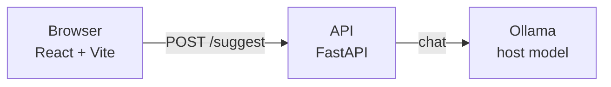

# 2048 with AI suggestions

A single-player 2048 game in the browser, with an optional AI coach that suggests the next move—and waits for you to confirm before anything is played.



- Play classic 2048 (keys or swipe); track score and session best.
- Ask for a suggestion (LLM by default; Expectimax is a placeholder).
- Confirm with **Play**, or ignore it and move yourself.

## Quick start

```bash
# Terminal 1 — Ollama on the host (model from OLLAMA_MODEL, default gemma4:latest)
# Terminal 2
cd server && uv sync --extra dev && uvicorn app.main:app --reload --host 127.0.0.1 --port 8000
# Terminal 3
cd client && npm install && npm run dev
```

Open `http://127.0.0.1:5173`. Or use Compose: `docker compose --profile dev up` (see [getting started](docs/getting-started.md)).

## Docs

| Audience | Start here |
|---|---|
| **Humans** — what this is and how it’s built | [docs/](docs/README.md) |
| **Agents** — rules, invariants, implementation detail | [AGENTS.md](AGENTS.md) → [docs/agents/](docs/agents/README.md) |
