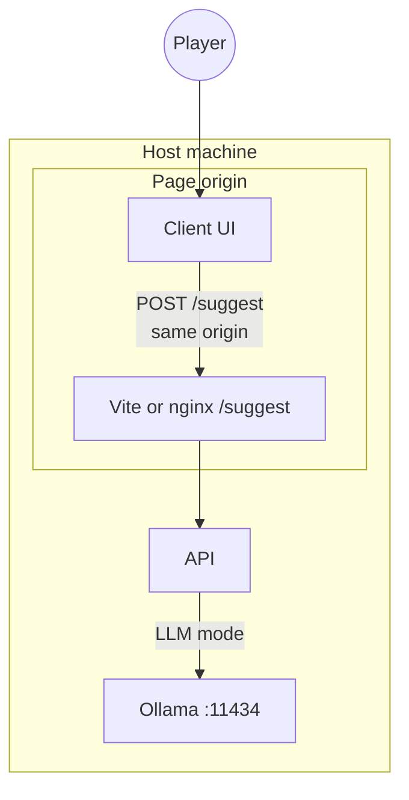
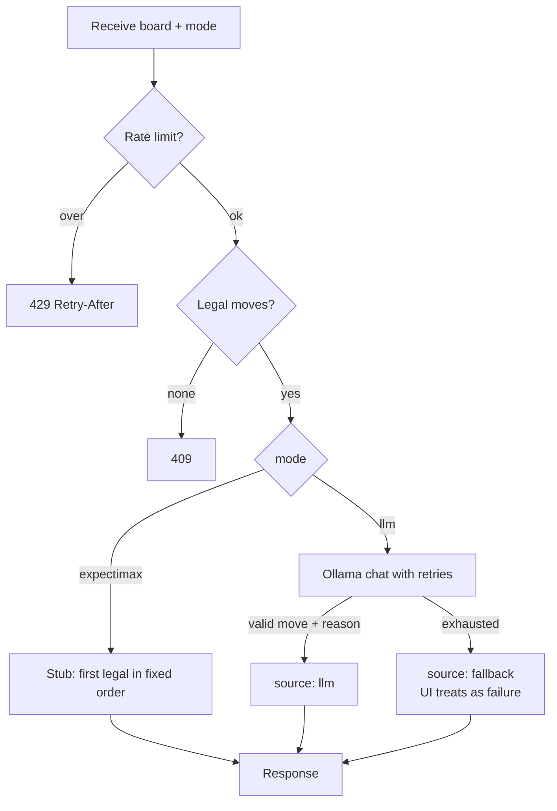
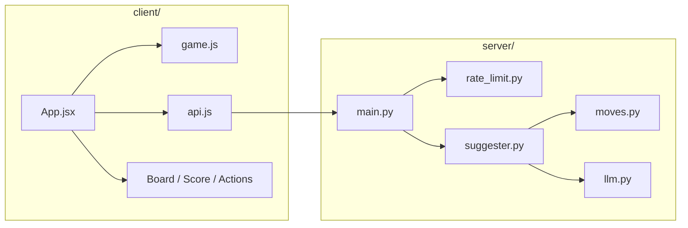

# Architecture

How the client, API, and host model fit together. File-level detail lives under [agents/](agents/README.md).

## System context

Ports bind to loopback. Host publish ports come from `API_HOST_PORT` / `CLIENT_HOST_PORT` (defaults 8000 / 5173) so worktrees can diverge. The browser calls same-origin `/suggest`; Vite (dev) or nginx (prod Compose) forwards to the API. Prod Compose does not publish the API host port.

## Suggestion path

The API stays healthy when Ollama is down (`GET /health` never calls the model). The client only offers **Play** (or auto-applies under **Auto Play**) when the suggestion is usable—not on fallback, rate limit, or transport errors. Auto Play is entirely client-side: it loops suggest → apply → settle without changing the API.

## Coarse module map

Client owns the playable rules and UI. Server owns suggestion modes, the process-wide rate limit, legality checks for the coach, and the Ollama client. Both sides implement the same slide/merge rules so “legal” means the same thing.

## Stack

| Layer | Choice |
|---|---|
| Client | React 19, Vite, plain JavaScript |
| API | Python 3.12, FastAPI, Pydantic |
| Model | Host Ollama (`OLLAMA_MODEL`, default `gemma4:latest`) |
| Run | Local processes or Docker Compose profiles `dev` / `prod` |
| CI | Lint, test, image build, Compose config checks |

## Deploy profiles

| Profile | What runs |
|---|---|
| `dev` | API with reload + Vite client (API published; Vite proxies `/suggest`) |
| `prod` | API unpublished + nginx static client on `CLIENT_HOST_PORT` (nginx proxies `/suggest`) |

Ollama always stays on the host. Compose reaches it via `host.docker.internal` (override with `COMPOSE_OLLAMA_BASE_URL`).

More runtime edge cases: [agents/runtime.md](agents/runtime.md).
