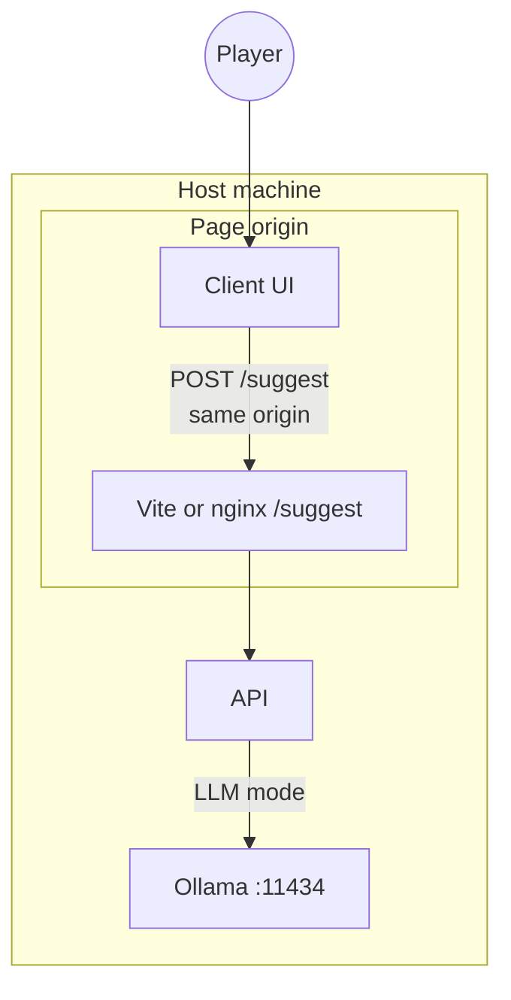
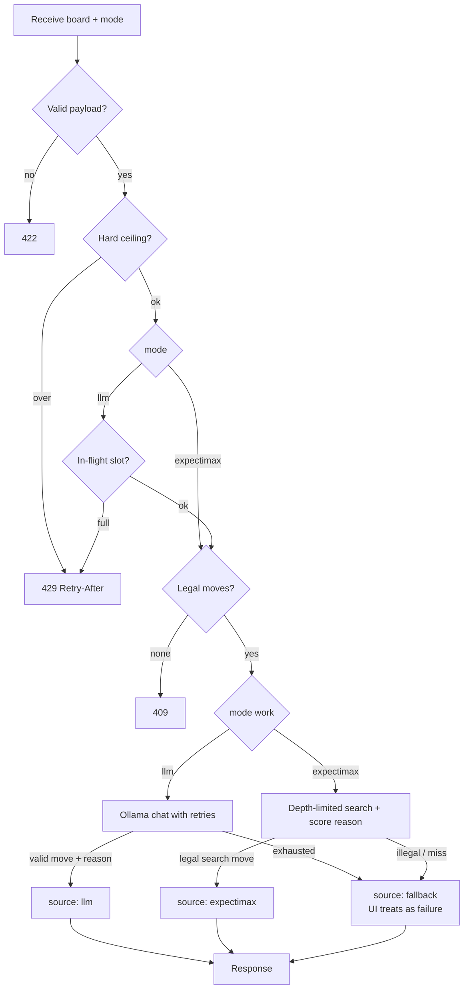
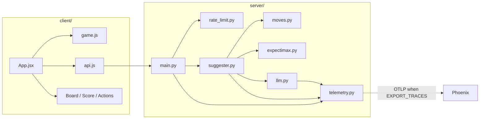

# Architecture

How the client, API, and host model fit together. File-level detail lives under [agents/](agents/README.md).

## System context

**Host-published** ports bind to loopback (`127.0.0.1` and `::1`). `CLIENT_HOST_PORT` maps the page (Vite/nginx); `API_HOST_PORT` maps the **dev** API only (defaults 8000 / 5173 so worktrees can diverge). Prod Compose publishes the client, not the API. The browser calls same-origin `/suggest`; Vite (dev) or nginx (prod Compose) forwards to the API.

## Suggestion path

Validation (`422`) runs before the rate-limit gates; invalid bodies do not consume either mode’s hard ceiling or an LLM in-flight slot.

The API stays healthy when Ollama is down (`GET /health` never calls the model). Expectimax never calls Ollama. The client only offers **Play** (or auto-applies under **Auto Play**) when the suggestion is usable—not on fallback, rate limit, or transport errors. Auto Play is entirely client-side: it loops suggest → apply → settle without changing the API. **Stop** / takeover aborts the in-flight `/suggest` fetch; the server watches for disconnect and cancels that request’s LLM/search work only (concurrent clients are supported in-process), responds `499`, refunds that request’s hard-ceiling token, and frees its LLM in-flight slot. The client treats abort and `499` as silent (`AbortError`); a token-matched abort still ends Auto Play so the loop cannot stall.

## Coarse module map

Client owns the playable rules and UI. Server owns suggestion modes, per-mode process-wide rate limits, legality checks for the coach, expectimax search, the Ollama client, Phoenix OTLP tracing when `EXPORT_TRACES` is on (default; collector optional), and always-on `GET /metrics` (optional Compose Prometheus/Grafana). Both sides implement the same slide/merge rules so “legal” means the same thing.

## Stack

| Layer | Choice |
|---|---|
| Client | React 19, Vite, plain JavaScript |
| API | Python 3.12, FastAPI, Pydantic |
| Model | Host Ollama (`OLLAMA_MODEL`, default `gemma4:latest`) |
| Run | Local processes or Docker Compose profiles `dev` / `prod` (+ optional `metrics`) |
| Observability | Phoenix (OTLP traces); `GET /metrics` + optional Prometheus/Grafana; inventory in [agents/telemetry.md](agents/telemetry.md) |
| CI | Docs scripts + link check, lint/test, client build, image build, Compose config checks |

## Deploy profiles

| Profile | What runs |
|---|---|
| `dev` | API with reload + Vite client (API published; Vite proxies `/suggest`) |
| `prod` | API unpublished + nginx static client (`${CLIENT_HOST_PORT}`→80; nginx proxies `/suggest`) |
| `metrics` | Prometheus + Grafana (pair with `dev` or `prod`) |

Ollama and Phoenix stay on the host. Compose reaches them via `host.docker.internal` (override with `COMPOSE_OLLAMA_BASE_URL` / `COMPOSE_PHOENIX_COLLECTOR_ENDPOINT`).

More runtime edge cases: [agents/runtime.md](agents/runtime.md).
