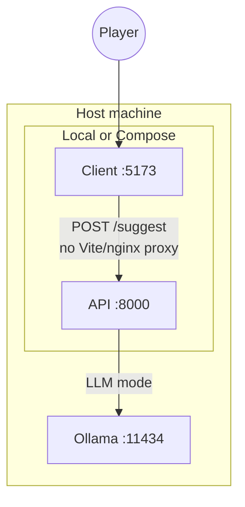
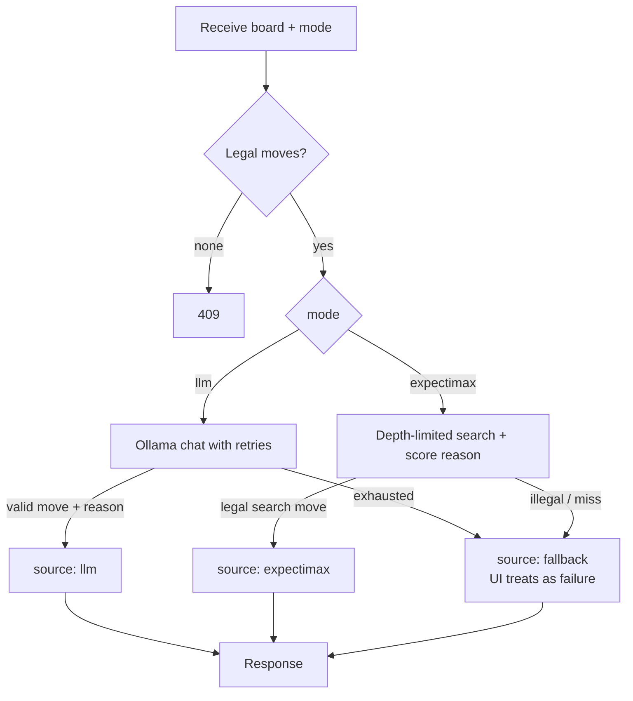
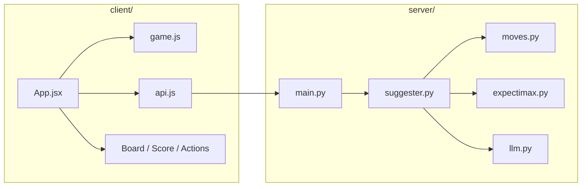

# Architecture

How the client, API, and host model fit together. File-level detail lives under [agents/](agents/README.md).

## System context

Ports bind to loopback. The browser talks to the API origin directly (`VITE_API_BASE_URL`, default `http://localhost:8000`).

## Suggestion path

The API stays healthy when Ollama is down (`GET /health` never calls the model). Expectimax never calls Ollama. The client only offers **Play** when the suggestion is usable—not on fallback or transport errors.

## Coarse module map

Client owns the playable rules and UI. Server owns suggestion modes, legality checks for the coach, expectimax search, and the Ollama client. Both sides implement the same slide/merge rules so “legal” means the same thing.

## Stack

| Layer | Choice |
|---|---|
| Client | React 19, Vite, plain JavaScript |
| API | Python 3.12, FastAPI, Pydantic |
| Model | Host Ollama (`OLLAMA_MODEL`, default `gemma4:latest`) |
| Run | Local processes or Docker Compose profiles `dev` / `prod` |
| CI | Lint, test, image build, Compose config checks |

## Deploy profiles

| Profile | What runs |
|---|---|
| `dev` | API with reload + Vite client |
| `prod` | API + nginx static client (still on host port 5173 for CORS) |

Ollama always stays on the host. Compose reaches it via `host.docker.internal` (override with `COMPOSE_OLLAMA_BASE_URL`).

More runtime edge cases: [agents/runtime.md](agents/runtime.md).
