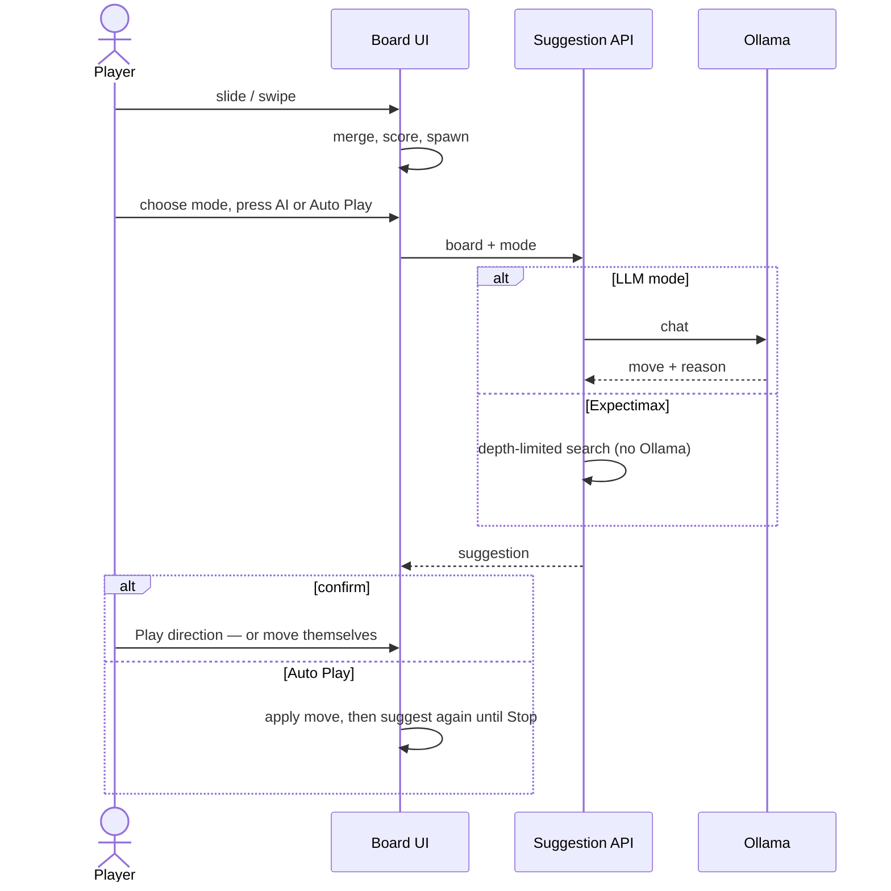

# Overview

A local or self-hosted 2048 session with an optional AI coach. No accounts, leaderboards, or multiplayer—just the board, score, and a suggestion you can take, ignore, or auto-play.

## Goals

1. Familiar 2048 with assignment tweaks: random count of starting **2**s (2–8), slide and merge, spawn after each successful move, hard win at **2048**.
2. Small surface: current score, session best, new game.
3. Optional AI: pick a mode, ask for a move, read the hint, confirm with **Play**, or turn on **Auto Play**.

## Player journey

## Modes

| Mode | Intent today |
|---|---|
| **LLM** (default) | Language model returns a legal move and a short reason. |
| **Expectimax** | Depth-limited search with spawn chance nodes; reason lists a score per direction (`N/A` if illegal). |

## Non-goals (for now)

Undo, cloud best scores, auth, multiplayer, deep tournament-strength search, native apps.

## Success looks like

- A visitor can play, lose, and start over without confusion.
- Best score survives **New Game** on the same page load; a full reload resets it.
- LLM or Expectimax suggest → reason → **Play** applies the move like any other input.
- **Auto Play** applies usable suggestions in a loop until Stop, loss, failure, or a manual move, using the currently selected mode. Capacity-busy responses retry briefly; spend rate limits stop the loop. Stop / takeover aborts an in-flight suggest (server cancels that run).
- A failed suggestion leaves the board unchanged with a clear message; abort / disconnect cancel is silent.

Full product rules for implementers: [agents/prd.md](agents/prd.md).
